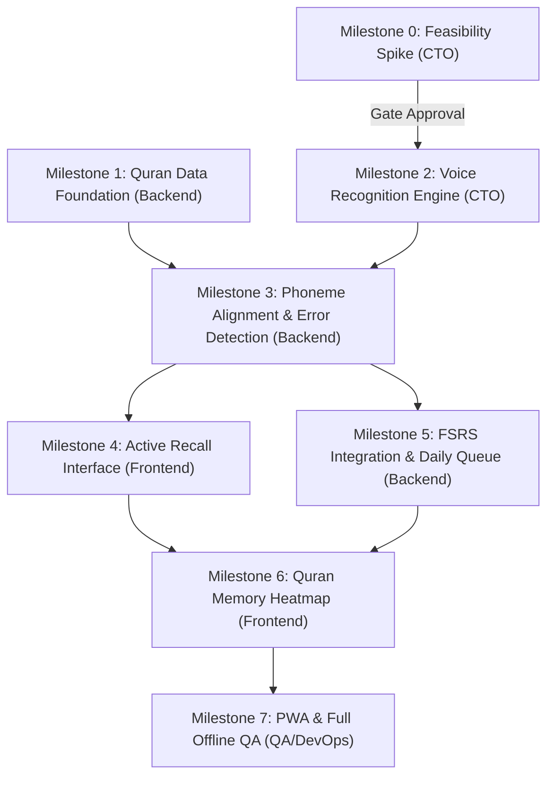

# Quran Cognitive OS (Version 2.0)
## Delivery Roadmap, Sprint Cadence & Acceptance Criteria

**Document Version:** 2.0.0  
**Status:** Approved & Baseline Established  
**Project Lead:** Project Manager (Delivery Lead)  
**Parent Initiative:** WHI-31 (Quran Cognitive OS — Execution Plan & Technical Architecture v2.0)  
**Engineering Oversight:** CTO & Core Engineering Team  

---

# 1. Delivery Framework & Operating Principles

Quran Cognitive OS v2.0 is a specialized cognitive platform engineered for Quran memorization and retention. The platform diverges from conventional mushaf readers by enforcing rigorous active recall, on-device voice assessment, and FSRS spaced repetition scheduling.

### 1.1 Non-Negotiable Product Guarantees
1. **Zero Text Entry During Recitation:** All memorization assessment is strictly voice-driven. No typing, multiple-choice, or character tapping during recitation tests.
2. **100% Client-Side Privacy (Zero Server Audio Transmission):** Raw audio and extracted acoustic features never leave the user's browser/device. All ML inference runs locally in WebAssembly via ONNX Runtime / sherpa-onnx.
3. **Sacrosanct Quranic Integrity:** Absolute textual accuracy matching the King Fahd Medina Mushaf (Hafs 'an Asim), 15 lines per page, verified against standard Tanzil/Medina checksums across all 114 Surahs and 6,236 Ayahs.
4. **Phoneme-Level Alignment (No Language Model Masking):** Recognition aligns directly against canonical phonetic representations (`ordered_quran_phonemes.json`), preventing language models from hallucinating correct text over reciter errors.
5. **Scientifically Grounded Memory Scheduling:** Retention probability and interval calculations are powered by the Free Spaced Repetition Scheduler (`ts-fsrs`).

---

# 2. Sprint Cadence & Governance Model

To balance high-risk technical spikes (on-device speech recognition in WASM) with steady product delivery, WhiteRoom Labs operates on a 2-week sprint cadence governed by strict milestone gates.



### 2.1 Cadence Schedule
- **Sprint Duration:** 2 calendar weeks (10 business days).
- **Heartbeat & Daily Sync:** Continuous async heartbeat synchronization across Paperclip agent roles.
- **Milestone Gating Reviews:** Formal gate check at the conclusion of each milestone. Work on downstream dependent milestones cannot enter `in_progress` until upstream gating criteria pass QA verification.
- **Quality Audits:** Every PR and commit must pass automated typechecks, linting, and targeted unit/integration tests.

---

# 3. Detailed Milestone Breakdown (Milestones 0 to 7)

### Milestone 0: Technical Feasibility Spike (Gating Prerequisite)
* **Goal:** Validate browser-native execution of Zipformer Quran 3.2 INT8 ONNX under WebAssembly (`sherpa-onnx`) with 80-dimensional Kaldi FBank features.
* **Lead:** CTO (`6566e04b-a8dd-44f1-8663-08c143d946d4`)
* **Tracking Issue:** WHI-33
* **Blocker Status:** None (Entry gate)
* **Concrete Acceptance Criteria (DoD):**
  - [x] Model weight `zipformer_p_arabic_v3.2.int8.onnx` and vocabulary `tokens.txt` loaded cleanly via WebAssembly.
  - [x] Audio input processed at 16,000 Hz mono using 80-dim Kaldi FBank with Povey window (Mel spectrogram strictly banned).
  - [x] Real-time factor (RTF) measured <= 0.35 on standard desktop/laptop hardware and <= 0.65 on mid-tier mobile browsers.
  - [x] Peak memory allocation for WASM runtime stays strictly below 350 MB.
  - [x] Zero network calls verified during feature extraction and streaming CTC inference.
  - [x] Signed technical decision document published detailing standard vs custom sherpa-onnx build requirements.

### Milestone 1: Quran Data Foundation & Local Schema
* **Goal:** Establish immutable Quran text corpus, 15-line Medina pagination, reference phoneme sequences, and Dexie.js IndexedDB schema.
* **Lead:** Backend Engineer (`bcc1a59d-ae22-4828-bab3-300aca7a0db2`)
* **Tracking Issue:** WHI-34
* **Blocker Status:** None (Runs in parallel with M0)
* **Concrete Acceptance Criteria (DoD):**
  - [x] Full database containing 114 Surahs and 6,236 Ayahs in Uthmani script with complete diacritics, ayah markers, and surah header metadata.
  - [x] Exact 15-line Medina Mushaf pagination mapping (pages 1 to 604, Juz 1 to 30, Hizb 1 to 60).
  - [x] Canonical phoneme mapping loaded (`ordered_quran_phonemes.json` and `quran_text2phoneme.json`) decoupled from display text.
  - [x] Dexie.js IndexedDB schema implemented with versioned stores: `quran_ayahs`, `memory_cards`, `transition_edges`, `review_logs`, and `mutashabihat_groups`.
  - [x] Automated test suite asserts 100% checksum parity against Tanzil/Medina corpus with zero missing or transposed characters.

### Milestone 2: Voice Recognition Engine
* **Goal:** Build real-time streaming audio pipeline capturing microphone input and generating CTC token streams via WebAssembly.
* **Lead:** CTO (`6566e04b-a8dd-44f1-8663-08c143d946d4`)
* **Tracking Issue:** WHI-37 (Milestone 2)
* **Blocked By:** WHI-33 (Milestone 0 Gate)
* **Concrete Acceptance Criteria (DoD):**
  - [ ] `AudioWorkletNode` captures user voice at 16 kHz mono with zero main-thread audio glitching or buffer dropouts.
  - [ ] Kaldi 80-dim FBank feature extraction runs in streaming chunks (e.g., 100ms-200ms windows).
  - [ ] CTC token stream emitted with timestamps and frame confidence scores.
  - [ ] Audio pipeline gracefully handles silence, voice pauses, background noise, and microphone disconnects.
  - [ ] Automated integration test feeds synthetic 16kHz WAV files and confirms deterministic CTC token emissions.

### Milestone 3: Phoneme Alignment & Error Detection
* **Goal:** Align streaming CTC phoneme tokens against reference Quranic phonemes and classify recitation errors.
* **Lead:** Backend Engineer (`bcc1a59d-ae22-4828-bab3-300aca7a0db2`)
* **Tracking Issue:** WHI-38 (Milestone 3)
* **Blocked By:** WHI-34 (Milestone 1 Data) & WHI-37 (Milestone 2 Audio Engine)
* **Concrete Acceptance Criteria (DoD):**
  - [ ] Dynamic Time Warping (DTW) / CTC alignment matches token stream to reference ayah phonemes with sub-100ms latency.
  - [ ] Error classification engine detects and categorizes:
    1. *Correct:* Exact phonetic match within threshold.
    2. *Omission:* Skipped words, phrases, or letters.
    3. *Substitution:* Incorrect word/letter recited.
    4. *Repetition:* Reciter stumbles and repeats words to regain composure.
    5. *Sequence Error:* Transposition of verses or out-of-order recitation.
    6. *Uncertain:* Low acoustic confidence requiring user repetition.
  - [ ] Word-level bounding maps alignment errors back to exact Uthmani word tokens for visual feedback.
  - [ ] Automated test suite verifies error classification against 25+ benchmark audio edge cases.

### Milestone 4: Active Recall Interface (Acquisition, Retention, Transition)
* **Goal:** Build the interactive Next.js + React UI supporting Medina 15-line layout, 3 Ghost Text tiers, recitation HUD, and error visualization.
* **Lead:** Frontend Engineer (`81c71344-f45e-4d18-af5e-0ffd6c00e864`)
* **Tracking Issue:** WHI-39 (Milestone 4)
* **Blocked By:** WHI-35 (App Scaffold) & WHI-38 (Milestone 3 Alignment)
* **Concrete Acceptance Criteria (DoD):**
  - [ ] Authentic Medina Mushaf 15-line layout rendered with responsive Uthmani typography and page navigation.
  - [ ] Ghost Text feature implemented with 3 distinct toggleable levels:
    - *Level 1 (Full Concealment):* Blank lines / invisible glyphs with ayah outline.
    - *Level 2 (First Words/Anchor Clues):* First 1-2 words visible per ayah.
    - *Level 3 (Key Landmarks):* Anchors and structural connectors visible.
  - [ ] Recitation HUD displays live mic activity, streaming word verification, and real-time stumbling feedback without revealing answers prematurely.
  - [ ] Post-recitation review highlights omissions in red, substitutions in amber, and correct recitations in emerald.
  - [ ] Zero text entry inputs present on any active recitation screen.

### Milestone 5: FSRS Integration & Daily Due Queue
* **Goal:** Integrate `ts-fsrs` algorithm to schedule spaced reviews, update memory stability/difficulty, and generate daily review queues.
* **Lead:** Backend Engineer (`bcc1a59d-ae22-4828-bab3-300aca7a0db2`)
* **Tracking Issue:** WHI-40 (Milestone 5)
* **Blocked By:** WHI-34 (Milestone 1 Data) & WHI-38 (Milestone 3 Error Analysis)
* **Concrete Acceptance Criteria (DoD):**
  - [ ] `ts-fsrs` configured with default retention target of 90% (R=0.90).
  - [ ] Automatic rating calculation derived from recitation error metrics:
    - *Easy (4):* Flawless recitation, zero omissions, minimal hesitation.
    - *Good (3):* Correct recitation with minor hesitation or self-correction.
    - *Hard (2):* Single omission or substitution corrected with struggle.
    - *Again (1):* Multiple errors, severe stumbling, or sequence breakdown.
  - [ ] Daily Due Queue dynamically computed from `memory_cards` where `due <= current_timestamp`, partitioned by New vs Due.
  - [ ] Transition edge cards scheduled independently to guarantee inter-ayah and page-boundary link stability.
  - [ ] Review logs persisted in Dexie with timestamps, duration, error counts, and FSRS state transitions.

### Milestone 6: Quran Memory Heatmap & Retrievability Analytics
* **Goal:** Visualize memorization strength across the entire Quran using the 15-line Medina Mushaf grid and retrievability mathematics.
* **Lead:** Frontend Engineer (`81c71344-f45e-4d18-af5e-0ffd6c00e864`)
* **Tracking Issue:** WHI-41 (Milestone 6)
* **Blocked By:** WHI-39 (Milestone 4 UI) & WHI-40 (Milestone 5 FSRS)
* **Concrete Acceptance Criteria (DoD):**
  - [ ] Retrievability score calculated dynamically per ayah:  
    $$R(t) = \left(1 + \text{factor} \times \frac{t}{S}\right)^{-1}$$
  - [ ] Color-coded Mushaf heatmap overlay:
    - $R \ge 95\%$: Neutral / Calm text color (Mastered).
    - $85\% \le R < 95\%$: Amber / Yellow tint (Review recommended).
    - $R < 85\%$: Warm Orange / Red tint (Critical lapse risk).
  - [ ] Comprehensive dashboard rollups:
    - Total memorized ayahs & pages.
    - Overall retention index.
    - Weakest Surahs and error hotspot clusters.
    - Due queue count breakdown.
  - [ ] Interactive drilldown: clicking any heatmap cell opens the respective Ayah Memory Card and review history.

### Milestone 7: PWA & Full Offline Quality Assurance
* **Goal:** Deliver offline service worker caching for application shell and ONNX weights, perform zero-leakage security audits, and verify end-to-end functionality.
* **Lead:** QA Engineer (`cf5edc79-90b7-493c-a212-936d44fec36c`) / DevOps
* **Tracking Issue:** WHI-42 (Milestone 7)
* **Blocked By:** WHI-41 (Milestone 6) & WHI-36 (QA Framework)
* **Concrete Acceptance Criteria (DoD):**
  - [ ] PWA installs seamlessly on Chrome, Safari (iOS 16.4+), and Firefox.
  - [ ] Model weights (~65MB INT8) and vocabulary cached into CacheStorage with persistent storage grant.
  - [ ] Zero Network Leakage Audit: DevTools Network panel confirms 0 HTTP/WS packets emitted during full voice recording, inference, and review flows in offline mode.
  - [ ] Complete offline journey passes: Airplane mode engaged -> app launches -> user recites ayah -> speech recognized locally -> FSRS updates Dexie -> heatmap updates.
  - [ ] Automated stress testing confirms no memory leaks across 50 consecutive recitation cycles.

---

# 4. User Interaction Flows & Story Mappings

### 4.1 Flow 1: Acquisition Mode (New Memorization)
```
[Select Surah/Ayah Range] 
       │
       ▼
[Initial Full Reading & Audio Listen (Optional)]
       │
       ▼
[Engage Ghost Text (Level 1 / 2 / 3)]
       │
       ▼
[Tap Microphone / Begin Voice Recitation]
       │
       ▼
[Live Streaming Speech Recognition & Dynamic Alignment]
       │
       ▼
[Immediate Visual Feedback: Omissions (Red) / Stumbles (Amber) / Correct (Green)]
       │
       ▼
[Mastery Check: 2 Consecutive Flawless Recitations -> Creates Initial FSRS Card]
```

### 4.2 Flow 2: Retention Mode (Spaced Review Queue)
```
[Open Daily Due Queue] 
       │
       ▼
[Present Prompt: Display Ayah Identifier & Clue (No Full Answer Text)]
       │
       ▼
[User Recites Ayah from Pure Memory into Microphone]
       │
       ▼
[Engine Calculates Phoneme Accuracy, Hesitation Delay & Error Count]
       │
       ▼
[System Assigns FSRS Rating (Again / Hard / Good / Easy)]
       │
       ▼
[Dexie.js Updates Stability, Difficulty, Next Review Date & ReviewLog]
       │
       ▼
[Advance to Next Due Card in Queue]
```

### 4.3 Flow 3: Transition Mode (Link Testing)
```
[Select Transition Test (Ayah Boundary or Page Turn)]
       │
       ▼
[System Displays Terminal Portion of Ayah N]
       │
       ▼
[Prompt: Seamlessly recite the bridge and opening words of Ayah N+1]
       │
       ▼
[Audio Engine Verifies Continuity without Pauses > 2.0s]
       │
       ▼
[Updates TransitionEdge Stability in Dexie.js]
```

---

# 5. Definition of Done (DoD) Standard

A task or milestone is officially declared **DONE** only when all conditions are fulfilled:
1. **Observable Criteria Met:** Every bulleted criterion in the milestone specification passes without exception.
2. **Automated Verification:** Targeted automated tests execute and pass in the repository.
3. **No Network Leakage:** Zero audio data transmitted over the wire; verified in network audit.
4. **Codebase Hygiene:** TypeScript compiles with zero errors (`tsc --noEmit`), linter clean, zero unhandled promise rejections.
5. **Traceability:** Corresponding Paperclip task status updated with inspectable artifacts and test evidence.

---

# 6. Delivery Tracking & Issue Matrix

| Milestone | Title | Owner | Blocked By | Paperclip Issue | Status |
|:---|:---|:---|:---|:---|:---|
| **M0** | Technical Feasibility Spike | CTO | *None* | WHI-33 | `in_progress` |
| **M1** | Quran Data Foundation & Schema | Backend | *None* | WHI-34 | `in_progress` |
| **UI-Scaffold** | Medina 15-Line Mushaf & Zustand | Frontend | *None* | WHI-35 | `in_progress` |
| **QA-Harness** | Quran Integrity & Benchmark Suite | QA | *None* | WHI-36 | `in_progress` |
| **M2** | Voice Recognition Engine | CTO | WHI-33 | WHI-37 | `blocked` |
| **M3** | Phoneme Alignment & Error Detection | Backend | WHI-34, WHI-37 | WHI-38 | `blocked` |
| **M4** | Active Recall Interface | Frontend | WHI-35, WHI-38 | WHI-39 | `blocked` |
| **M5** | FSRS Integration & Daily Queue | Backend | WHI-34, WHI-38 | WHI-40 | `blocked` |
| **M6** | Quran Memory Heatmap & Analytics | Frontend | WHI-39, WHI-40 | WHI-41 | `blocked` |
| **M7** | PWA & Full Offline Quality Assurance | QA / DevOps | WHI-41, WHI-36 | WHI-42 | `blocked` |

---
*Maintained by PM, WhiteRoom Labs. Aligned with Quran Cognitive OS v2.0 Architecture Specification.*
